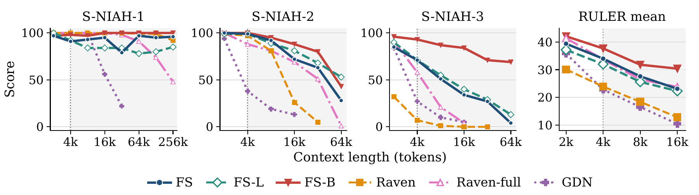
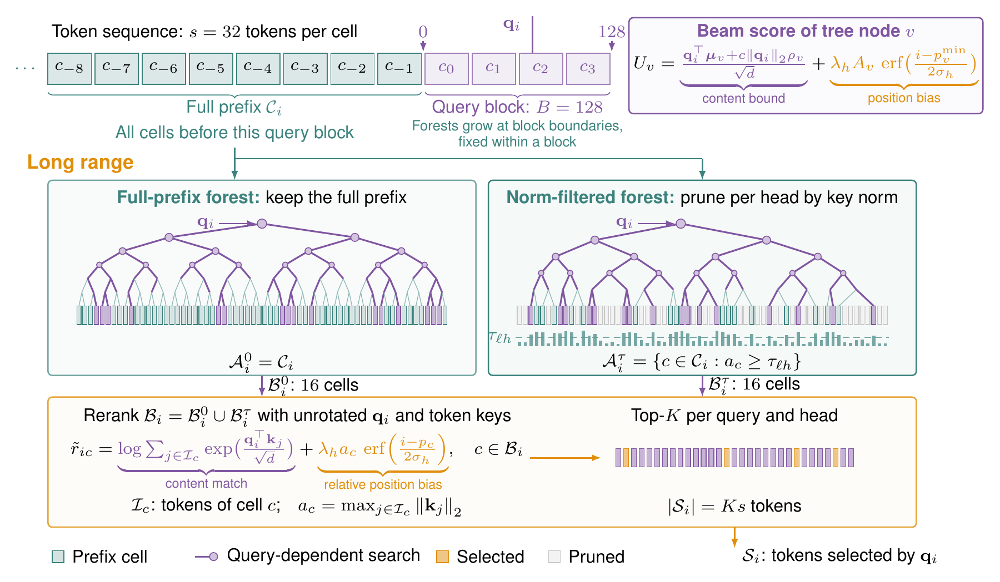

<div align="center">

# FreeSolo

**Subquadratic sparse attention that zero-shot length extrapolates to 256k+ tokens.**

[Paper](https://arxiv.org/abs/2610.17191) ·
[Hugging Face](https://huggingface.co/collections/zekun-shi/freesolo-6acf9578abafcae91b20b368) ·
[License](LICENSE)



</div>

FreeSolo learns **chunk mean keys** that support search, pruning, and hierarchical summarization. RoPE stays in the local window; the long-range branch reads selected 32-token chunks without rotating queries or keys.

<div align="center">

</div>

Two inference variants share one checkpoint format:
- **FS-L** — linear time. Retains a bounded pool of chunks by key norm and recency, then reads four selected chunks.
- **FS-B** — superlinear, subquadratic. Searches two forests (full-prefix and norm-filtered), reranks their candidates, and reads four chunks, keeping a growing searchable prefix.

## Results

RULER accuracy, ~800M scale; all models train at 4k, results at 8k and above test zero-shot extrapolation (**bold** = best, <u>underline</u> = second best within each cost block):

| Model | Complexity | Mean 2k | 4k | 8k | 16k |
| --- | --- | ---: | ---: | ---: | ---: |
| TF++ | O(N²) | **46.3** | <u>37.5</u> | 0.0 | 0.0 |
| NSA | O(N²/b) | 40.7 | 24.8 | 2.6 | 0.1 |
| Raven-full | O(N²) | 41.4 | 33.7 | 26.5 | <u>23.8</u> |
| FS | O(N²/s) | 39.4 | 34.0 | <u>27.6</u> | 23.1 |
| **FS-B** | O(N log² N) | <u>42.1</u> | **37.7** | **31.8** | **30.4** |
| **FS-L** | O(N) | **37.2** | **32.0** | **25.6** | **22.3** |
| Raven | O(N) | 30.1 | <u>23.9</u> | <u>18.4</u> | <u>12.8</u> |
| NAtS-L | O(NR) | 27.8 | 19.4 | 10.2 | 2.8 |
| GDN | O(N) | <u>35.8</u> | 22.8 | 16.5 | 10.4 |
| SWA | O(N) | 15.6 | 10.3 | 5.5 | 4.0 |

Both variants retrieve single needles at 262k — 64x the training length — without long-context fine-tuning (task-specific result, not a guarantee for arbitrary inputs). Per-task tables, 340M results, and common-task breakdowns are in the [paper](https://arxiv.org/abs/2610.17191).

### Inference efficiency

340M scale on one A100-40GB (bf16, batch 1, each model's fastest CUDA-graph serving path; `*` = eager fallback on a path without graph capture, `experiments/scaling/bench_efficiency.py`):

| Model | Prefill, Ktok/s (4k/16k/64k/131k) | Decode, tok/s (4k/16k/64k/131k) | Prefill peak, GiB (4k/16k/64k/131k) | Decode peak, GiB (4k/16k/64k/131k) |
| --- | --- | --- | --- | --- |
| TF++ (full attention) | 159.3 / 119.8 / 48.4 / 26.2 | 264.5 / 199.8 / 95.8 / 55.5 | 1.6 / 3.6 / 11.8 / 22.8 | 1.5 / 3.6 / 11.8 / 22.8 |
| SWA (sliding-512) | 184.0 / 233.5 / 236.5 / 235.4 | 330.8 / 336.3 / 329.0 / 325.5 | 1.0 / 2.0 / 5.7 / 10.7 | 1.0 / 2.0 / 5.7 / 10.6 |
| MoBA | 84.0 / 84.0 / 40.0 / 22.3 | 261.4 / 196.1 / 95.4 / 55.4 | 1.6 / 3.6 / 11.9 / 23.1 | 1.5 / 3.6 / 11.8 / 23.5 |
| NSA | 129.2 / 136.8 / 104.6 / 76.1 | 153.8 / 149.2 / 143.1 / 139.7 | 1.0 / 2.0 / 5.8 / 11.0 | 1.0 / 1.9 / 5.8 / 11.0 |
| GDN | 145.6 / 170.7 / 174.5 / 174.1 | 349.9 / 368.3 / 357.8 / 339.0 | 1.1 / 1.9 / 5.3 / 9.7 | 1.1 / 1.9 / 5.2 / 9.6 |
| NAtS-L | 60.1* / 154.0* / 154.0* / 134.9* | 267.8 / 233.7 / 172.3 / 118.2 | 1.2* / 2.6* / 8.2* / 15.6* | 1.4 / 3.1 / 9.9 / 19.0 |
| Raven (recurrent) | 141.6 / 171.1 / 176.7 / 176.7 | 238.1 / 236.7 / 245.6 / 238.5 | 1.0 / 1.8 / 5.1 / 9.5 | 0.9 / 1.8 / 5.1 / 9.5 |
| Raven-full | 102.3 / 112.4 / 101.6 / 88.5 | 234.8 / 232.6 / 211.7 / 182.7 | 1.0 / 1.9 / 5.5 / 10.3 | 1.1 / 2.1 / 6.0 / 11.3 |
| **FS** | 138.7 / 173.3 / 154.4 / 132.6 | 337.5 / 321.3 / 273.2 / 227.5 | 1.3 / 2.5 / 7.4 / 14.0 | 1.3 / 2.5 / 7.5 / 14.1 |
| **FS-L** (masked) | 134.3 / 176.7 / 181.1 / 181.5 | 342.7 / 339.9 / 340.5 / 340.6 | 1.3 / 2.5 / 7.4 / 14.0 | 1.3 / 2.5 / 7.5 / 14.1 |
| **FS-B** | 85.9 / 94.2 / 82.2 / 76.2 | 340.2 / 322.1 / 304.9 / 300.0 | 1.3 / 2.8 / 8.1 / 15.2 | 1.3 / 2.8 / 8.3 / 15.9 |

## Models

| Model | Parameters | Hugging Face repo |
| --- | ---: | --- |
| FreeSolo (base FS) | 341M / 743M | [FreeSolo-341M](https://huggingface.co/zekun-shi/FreeSolo-341M) · [FreeSolo-743M](https://huggingface.co/zekun-shi/FreeSolo-743M) |
| FS-L | 341M / 743M | [FreeSolo-L-341M](https://huggingface.co/zekun-shi/FreeSolo-L-341M) · [FreeSolo-L-743M](https://huggingface.co/zekun-shi/FreeSolo-L-743M) |
| FS-B | 341M / 743M | [FreeSolo-B-341M](https://huggingface.co/zekun-shi/FreeSolo-B-341M) · [FreeSolo-B-743M](https://huggingface.co/zekun-shi/FreeSolo-B-743M) |

All models have 24 layers and 16 heads, trained on FineWeb-Edu at a 4,096-token context; they are research base models without instruction tuning. Tokenizer: `fla-hub/transformer-1.3B-100B`. The FS-B repos include `union_calibration.json`: the two-forest thresholds, bound to each checkpoint's weight checksum. A checkpoint's card specifies its variant, architecture flags, and evaluation provenance; the native Hub loader reads `config.json` and applies these settings automatically. The lower-level evaluation launchers still take explicit flags. Loading uses the FreeSolo package.

## Quickstart

Install a CUDA build of PyTorch, then FreeSolo:

```bash
python -m pip install torch==2.5.1 --index-url https://download.pytorch.org/whl/cu121
python -m pip install git+https://github.com/zekun-shi/freesolo.git
freesolo-generate --model zekun-shi/FreeSolo-B-341M --output generation.json
```

The [retrieval example](examples/hf_generate.py) downloads the weights, configuration,
and calibrated thresholds from the Hub, then retrieves **5437923** from a short
prompt. It records the exact model revision, weight checksum, and generated tokens
in `generation.json`. Use `--model zekun-shi/FreeSolo-L-743M` for FS-L or select
another checkpoint from the table above.

### Reproduce inference speed

Run the [Hub benchmark](examples/hf_benchmark.py) on one idle A100-40GB:

```bash
CUDA_VISIBLE_DEVICES=0 freesolo-benchmark --model zekun-shi/FreeSolo-341M \
  --lengths 65536,131072 --output hf-benchmark-fs.json
CUDA_VISIBLE_DEVICES=0 freesolo-benchmark --model zekun-shi/FreeSolo-L-341M \
  --lengths 65536,131072 --output hf-benchmark-fsl.json
CUDA_VISIBLE_DEVICES=0 freesolo-benchmark --model zekun-shi/FreeSolo-B-341M \
  --lengths 65536,131072 --output hf-benchmark-fsb.json
```

The command downloads the checkpoint (and portable thresholds for FS-B), then invokes the
paper's benchmark with bf16, batch 1, one warm-up, three measured repetitions,
256 decode steps, and no memory cap. It prints eager and CUDA-graph measurements;
compare the graph columns with **154.4/132.6 Ktok/s prefill** and **273.2/227.5 tok/s decode** for `FreeSolo-341M`, **181.1/181.5 Ktok/s prefill** and
**340.5/340.6 tok/s decode** for `FreeSolo-L-341M`, or **82.2/76.2 Ktok/s prefill** and
**304.9/300.0 tok/s decode** for `FreeSolo-B-341M` at 64k/131k. GPU clocks, host load, and software versions
affect timing. The JSON includes graph/eager logit checks and kernel fallback status.
The reference stack uses PyTorch 2.5.1+cu121 and Triton 3.1.0.

For direct use of `experiments/scaling/bench_efficiency.py`, supply
`--fsb_union_tau_file MODEL_DIR/union_calibration.json --fsb_union_tau_quantile 0.5`.
The packaged thresholds remove the training-corpus dependency.

FS-L defaults to the masked inference path used for the accuracy and speed tables.
Add `--bounded-cache` to `freesolo-generate` to use its bounded streaming cache.

Full evaluation drivers are `scripts/eval_ruler_fs.sh`, `scripts/eval_ruler_fsl.sh`,
and `scripts/eval_ruler_fsb.sh`. Generate their inputs with
`scripts/gen_ruler_data.sh` from a checkout. Further drivers cover commonsense
(`eval_downstream.py`), LongBench-E (`eval_longbench.py`), and shared-prefix
retrieval (`eval_multifact.py`). Training and CPT recipes live in `scripts/`.

## Validation

```bash
python -m pytest tests/test_cell_smoke.py tests/test_strict_causal.py \
  tests/test_release_calibration.py tests/test_release_evaluation.py -q
python tests/test_fsb_tree.py   # the full FS-B suite, needs a CUDA GPU
```

All `FSB_*` / `FSL_*` serving-path switches default to the fastest path that reproduces the reference outputs; each module's docstring documents its switch and its exact-numerics claim. Reference accuracy, bounded streaming, eager decode, and CUDA-graph decode are distinct configurations — compare numbers only with a matching checkpoint, selector, precision, and decode path (reference stack: PyTorch 2.5.1+cu121, Triton 3.1.0, A100-40GB).

## Citation

```bibtex
@misc{shi2026freesolo,
  title         = {FreeSolo: Linear-time Sparse Attention with Zero-Shot Length Extrapolation},
  author        = {Zekun Shi and Alastair James Arthur Price},
  year          = {2026},
  eprint        = {2610.17191},
  archivePrefix = {arXiv}
}
```

## License

MIT, see [LICENSE](LICENSE).
